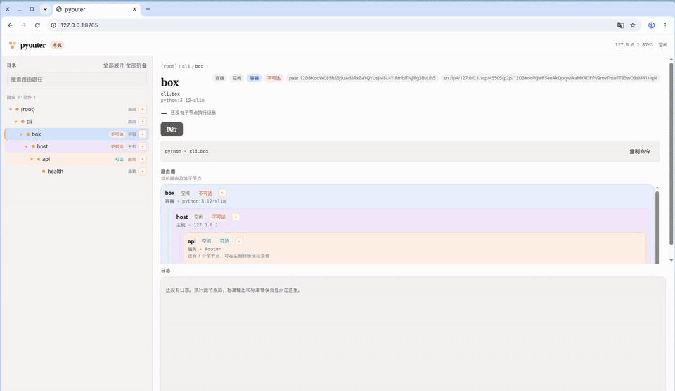

# Pyouter

Pyouter is a tasks router by  hierarchy and layered tasks, which may come from command line or http restful api

Deepwki: https://deepwiki.com/fanfeilong/pyouter



## INSTALL

install pyouter

```shell
pip install pyouter
```

* advanced: [install for shell completion support](./advanced.md)

## examples

* [src/tests/test.py](src/tests/test.py)
  * depends: [src/tests/config.json](src/tests/config.json)

minimal example code for pyouoter:

```python
from typing import Any
from pyouter.app import App
from pyouter.router import Router

import json
import asyncio
import time


async def hello(config, options):
    print("hello function")
    
def hello_sync(config, options):
    print("hello sync")

class Hello:
    def __init__(self, value) -> None:
        self.value = value
    
    # Router class SHOULD provider method: `run(self, config, options)`
    async def run(self, config, options) -> Any:
        self.config = config
        self.options = options
        await self.inner()
    
    async def inner(self):
        print(f"run Hello, {self.value}")
        await asyncio.sleep(2)
        print(f"hello class object, self.options.debug:{self.options.debug}, sleep 2s")
        if self.options.debug:
            print(f'debug, {self.value}')
            
class Hello_Sync:
    def __init__(self, value) -> None:
        self.value = value
    
    # Router class SHOULD provider method: `run(self, config, options)`
    def run(self, config, options) -> Any:
        self.config = config
        self.options = options
        self.inner()
    
    def inner(self):
        print(f"run Hello_Sync, {self.value}")
        time.sleep(self.value)
        print(f"hello class object, self.options.debug:{self.options.debug}, sleep {self.value}s")
        if self.options.debug:
            print(f'debug, {self.value}')

if __name__=="__main__":
    '''
    Usage:
        ## start pyouter, then route into that process:
        * python test.py
        * python test.py test.hello.func
        * python test.py test.hello.obj
        * python test.py test
        
        ## dump router path only:
        * python test.py test.hello -i
        * python test.py test.hello --insepect
        
        ## dump router path and execute:
        * python test.py test.hello -v
        * python test.py test.hello --view

        ## browse and run in a local web ui:
        * python test.py --web
        * python test.py test.hello --web --no-browser
    '''
    
    app = App(
        config='config.json',
    )
    
    app.option(
        '-d', '--debug',
        dest='debug',
        action="store_true",
        help='debug'
    )
    
    app.use(
        router=Router(
            test=Router(
                hello=Router(
                    func=hello,
                    obj=Hello("world"),
                    obj2=Hello_Sync(10)
                ),
                hello2=hello,
                hello3=Router(
                    func=hello_sync,
                    obj=Hello("world"),
                    obj2=Hello_Sync(20),
                )
            )
        )
    )
    
    app.run()
    
    
```

## framework

An application is a router tree plus one context per run. `use()` replaces the tree. `include()` mounts another tree, optionally under a prefix. A leaf is still a function or an object with `run`. A single parameter receives a `Context`; two parameters keep the `(config, options)` form. An object's `run` method follows the same rule.

```python
from pyouter.app import App
from pyouter.router import Router

async def hello(ctx):
    ctx.log(ctx.config["name"])
    return ctx.options.debug

app = App(config={"name": "pyouter"})
app.include(Router(hello=hello))
app.run()
```

```shell
python app.py
python app.py hello
```

`python app.py` starts one process and leaves it running. Every later command routes a node into that process, prints the result, and exits. A function, a router, a web service, and a web endpoint are the same kind of step: the process you started is what executes the node. The command delivers the path.

`python app.py hello` runs `hello` there. An object keeps its state across commands, because those commands stay on the worker that first ran it. A second `python app.py` prints `pyouter already running`. `python app.py --worker` joins the pools as another process. A command issued before the first process exists fails and tells you to start it. `--tasks` and `--tree` only read the route tree, so they run in the command itself.

Calling `run()` after you have set `options` executes in the current process. Tests and embedded callers use that path.

After a run, `app.result.exit_code` is 1 when a node fails, and `run()` raises `SystemExit`. A context action's return value is `app.result.root.value` when that action is the node that was executed.

Router nodes run their children in parallel. `policy="sequence"` runs them in order. Child failures are collected into `app.result` and the process exits with code 1. `ctx.cancelled` is set when a local web run is stopped.

## local web

https://cursor.com/artifacts/v/art-1cdde7f3-5756-49a3-97ac-2d54dc193da9

Open the current router in a browser. The server binds to `127.0.0.1:8765` and uses only the Python standard library.

```shell
python test.py --web
python test.py --web --port 9000
python test.py test.hello --web --no-browser
```

`--web` starts the same pyouter process and opens the browser on it. A later `python test.py test.hello.func` routes into that process. The left column is the route tree. The right panel shows the selected node's status, a map of the nearby routes, and the logs captured from that node's standard output and standard error. Click a node to inspect it. Use ▶, double-click, or 执行 to run it. Running a router runs its children, same as the command line.

`app.web()` starts the same page from Python. `--host` defaults to localhost; binding another interface exposes task execution on that interface.

## web services

A route is a command (`cli`), a router (`router`), or a web endpoint (`web`). `node_kind` reports which. A Flask or FastAPI application used to sit in the tree as one opaque node, so the routes declared inside it were invisible. Mounting the application flattens each HTTP route into a pyouter node. The command line, `--tasks`, and the local web ui then see those routes.

Flask and FastAPI are not required to install pyouter. They are imported only by the application you mount.

```python
from flask import Flask
from pyouter.app import App

service = Flask(__name__)

@service.get("/health")
def health():
    """service is up"""
    return {"ok": True}

@service.get("/users/<int:user_id>")
def user(user_id):
    return {"user_id": user_id}

app = App(config={})
app.option("--user-id", dest="user_id")
app.include(service, prefix="api")
app.run()
```

```shell
python app.py
python app.py api
python app.py api.health
python app.py api.users.user_id --user-id 7
python app.py --tasks
```

`python app.py` is the process that stays up. `python app.py api` routes to the service node inside it and waits there while Flask listens on `127.0.0.1:5000`. `python app.py api.health` routes to that endpoint: one `GET /health` against the service already listening in the same process, then the command exits. `api.users.user_id` is `GET /users/<int:user_id>`, routed the same way. `python app.py hello`, for an ordinary function mounted beside the service, is also a route into this process.

A path parameter is taken from an option of the same name, from `options.params`, or from config. Several methods on one path become `get`, `post`, and the other method names. The request returns `status`, `body`, `method`, and `path`. A response of 400 or higher fails the node. If the service node is not running, the route fails and tells you to start it. Running the service node again, while it is already listening, reports that and leaves the service in place. Stopping the `api` command stops the service. The pyouter process keeps running.

`app.include(service, prefix="api", port=5000)` selects the address. `flatten(service, port=5000)` returns the same router when you want to mount it yourself. A FastAPI application listens on `127.0.0.1:8000` unless you pass a port, and starting it needs `uvicorn`. `GET /users/{user_id}` becomes `users.user_id`.

## containers

A container is a node too. Commands and HTTP services inside it are child nodes, so a path such as `a.b.c.d` reaches through the container `b` into `c` and then `d`. Docker is not required to install pyouter. The `docker` executable is used only when a container node runs.

```python
from pyouter.app import App
from pyouter.docker import Command, Container, Service
from pyouter.router import Router

box = Container(
    "python:3.12-slim",
    name="tools",
    workers=2,
    ports=("8080:80",),
    routes=Router(
        c=Router(
            d=Command("echo", "deep"),
        ),
        api=Service(
            "http://127.0.0.1:8080",
            health=("GET", "/health"),
        ),
    ),
)

app = App(config={})
app.include(Router(a=Router(b=box)))
app.run()
```

```shell
python app.py
python app.py a.b
python app.py a.b.c.d
python app.py a.b.api.health
```

`python app.py a.b` starts the container and waits. The container's main process is another pyouter, serving the `routes` you passed. `workers=2` starts that many pyouter processes inside the container. `a.b.c.d` is handed to that inner pyouter, which runs `echo deep` on one of those processes. `a.b.api.health` sends `GET /health` to the published address. Both fail, and say to start the container, when `a.b` is not running. Running `a.b` again while it is running reports that and leaves the container in place. Stopping the `a.b` command removes the container it started. The outer pyouter process keeps running.

The image needs Python. pyouter mounts its source and the application script and starts them; you do not write a Dockerfile. `command=("nginx", "-g", "daemon off;")` replaces the inner runtime when the image itself is the service. A nested router such as `c` is only another path segment.

A Compose file is the same kind of node, one level up. Each service in the file is a child. Commands and HTTP routes are added onto a service by name. Mount the project with a prefix; that prefix is what starts the stack. A `.yml` file needs PyYAML. A `.json` Compose file does not.

```python
from pyouter.docker import Command, Compose, Service
from pyouter.router import Router

stack = Compose(
    "compose.yaml",
    project="demo",
    routes=Router(
        web=Router(ping=Command("echo", "web")),
        api=Service("http://127.0.0.1:8080", health=("GET", "/health")),
    ),
)
app.include(stack, prefix="stack")
```

```shell
python app.py stack
python app.py stack.web
python app.py stack.web.ping
python app.py stack.api.health
```

`python app.py stack` runs `docker compose up -d` and waits. `stack.web` is the `web` service from the file. `stack.web.ping` is `docker compose exec` inside that service. `stack.api.health` sends one request to the published address. Stopping the `stack` command runs `docker compose down` for the stack it started.

## ssh

An SSH host is a node too. Commands on that host are child nodes, so `a.b.c.d` runs on the host named `b`. The `ssh` program is used only when the host node runs. The connection does not ask for a password; it uses the keys and agent already available to `ssh`.

```python
from pyouter.app import App
from pyouter.docker import Service
from pyouter.router import Router
from pyouter.ssh import Remote, SSH

edge = SSH(
    "10.0.0.8",
    user="deploy",
    forwards=("8080:127.0.0.1:80",),
    routes=Router(
        c=Router(d=Remote("echo", "deep")),
        api=Service(
            "http://127.0.0.1:8080",
            health=("GET", "/health"),
        ),
    ),
)

app = App(config={})
app.include(Router(a=Router(b=edge)))
app.run()
```

```shell
python app.py
python app.py a.b
python app.py a.b.c.d
python app.py a.b.api.health
```

`python app.py a.b` opens one connection and waits. `a.b.c.d` runs `echo deep` on `deploy@10.0.0.8`. `a.b.api.health` sends `GET /health` through the local forward. Both fail, and say to start the ssh node, when `a.b` is not connected. Running `a.b` again while it is connected reports that and leaves the connection in place. Stopping the `a.b` command closes the connection it opened. The pyouter process keeps running.

Mount the host with a prefix, or place it under a name as `b` is placed above. `forwards` are `ssh -L` values.

## layers

A route tree can nest any of these nodes. Three of them start a new load balancer, so crossing one is a new layer:

| node | layer | what the parent pool does | what this layer's pool does |
| --- | --- | --- | --- |
| container | docker | one worker starts and owns the container | balances every call under the container |
| SSH host | ssh | one worker opens and owns the connection | balances every call on that host |
| web service | server | one worker starts and owns the listener | balances every request the service handles |

A listening server is a layer. It has its own worker pool. The cli process you start is the outermost pool, and it is not a crossing.

`cli > docker > ssh > docker > server` is four layers. A call that lands on a layer node stays on one worker of the parent. A call that goes past that node is balanced inside the layer.

```python
from pyouter.docker import Container
from pyouter.flatten import flatten
from pyouter.ssh import SSH
from pyouter.router import Router

api = flatten(service, workers=4)
inner = Container("python:3.12-slim", name="inner", routes=Router(api=api), workers=3)
jump = SSH("10.0.0.9", routes=Router(box=inner), workers=2)
edge = Container("python:3.12-slim", name="edge", routes=Router(host=jump), workers=2)
app.include(Router(cli=Router(box=edge)))
```

`cli.box` is the outer container node: the cli pool owns it. `cli.box.host.box.api.health` is inside the server, so the server's 4 workers balance that call. Each layer on the way has already handed the call to the next pool.

| place | parameter | default | effect |
| --- | --- | --- | --- |
| container, SSH host, web service | `balancer` | `uvicorn` | which provider starts that layer's pool |
| container, SSH host, web service | `workers` | `1` | how many processes that pool starts |
| container, SSH host, web service | `runtime` |  | `http://host:port` for a direct dial, or a peer id reached through the control process's super nodes |

The provider is an internal detail of the pool. You set `balancer` and `workers`. Replacing the provider is `register_provider(name, start)` and passing that name as `balancer`.

## deploy

The runtime is the pyouter package. `deploy_tree` installs that package on the machine named by `runtime`, then pushes the layer. A listener that already answers `/health` is left in place. A later push replaces the pool.

| where the layer runs | how the package gets there |
| --- | --- |
| `runtime` is on this machine (`127.0.0.1`) | `deploy_tree` starts `python -m pyouter.node` here |
| an SSH host, or a layer reached through one | the first contact copies the package to `~/.pyouter/runtime` over that host's `ssh` and starts the listener |
| a container started from this machine | starting the container mounts the package; no Dockerfile is written |

```python
edge = Container("python:3.12-slim", routes=..., workers=2, runtime="http://127.0.0.1:7710")
jump = SSH("10.0.0.9", routes=..., workers=2, runtime="http://10.0.0.9:7710")
api = flatten(service, workers=4, runtime="http://10.0.0.9:7711")
```

`deploy_tree(app.router)` is the control call. A layer with no `runtime` is not deployed. A remote address that is not an SSH host, and is not reached through one, is refused: there is no path to copy the package there.

A runtime is also a peer. The section below is the full startup, the tree, and the checks.

| | pyouter | Kubernetes |
| --- | --- | --- |
| what is placed | one layer of the tree | a pod |
| who chooses the machine | the `runtime` written on that layer | the scheduler |
| what is already on the machine | a way to reach it: this process, or `ssh` | a kubelet reconciling pod specs |
| what starts the work | the installed runtime starts that layer's pool | the kubelet starts containers from images |
| what a second push does | replaces the pool serving that slice | reconciles toward the new spec |

One measured run after a slice was pushed to a node runtime. Four concurrent calls each occupy a process for 0.3s:

| workers | calls | hold | elapsed | processes used | speedup |
| --- | --- | --- | --- | --- | --- |
| 1 | 4 | 0.3s | 1.205s | 1 | 1 |
| 4 | 4 | 0.3s | 0.305s | 4 | 3.95 |

Four processes finish the same concurrent work in about a quarter of the time. One process runs the calls one after another. The test requires the larger pool to be at least 1.5 times faster.

## peers

A runtime is one peer. Start the super node, start each layer's runtime with that super node's multiaddr, copy the peer id it prints into `runtime`, then call `deploy_tree`. The layer does not store the super node. The control process carries the list.

`runtime="http://127.0.0.1:7711"` still dials that URL and does not use the list.

### start

On the machine that other peers can reach, start the super node. `--identity` is the key file. The same file is the same peer id after a restart. The default file is `~/.pyouter/peer/identity`.

```bash
python -m pyouter.node --port 7710 --identity ~/.pyouter/peer/sn --sn-listen 127.0.0.1:4001
```

```text
node 7710
peer 12D3KooWSnA...
sn /ip4/127.0.0.1/tcp/4001/p2p/12D3KooWSnA...
```

`node` is the HTTP port for a direct `runtime`. `peer` is the id you copy into a layer when this process is the one that should receive the slice. `sn` is the multiaddr every other runtime passes to `--sn`.

Start the runtime for one layer, and point it at that multiaddr:

```bash
python -m pyouter.node --port 7711 --identity ~/.pyouter/peer/api \
  --sn /ip4/127.0.0.1/tcp/4001/p2p/12D3KooWSnA...
```

```text
node 7711
peer 12D3KooWApi...
joined 12D3KooWSnA...
```

`joined` is the super node this runtime reserved on. `joined none` means every `--sn` failed. A later deploy to this peer id does not deliver the slice.

A second super node is another process. A runtime connects to every entry that answers:

```bash
python -m pyouter.node --port 7720 --identity ~/.pyouter/peer/sn-b --sn-listen 127.0.0.1:4002 \
  --sn /ip4/127.0.0.1/tcp/4001/p2p/12D3KooWSnA...
```

```text
node 7720
peer 12D3KooWSnB...
sn /ip4/127.0.0.1/tcp/4002/p2p/12D3KooWSnB...
joined 12D3KooWSnA...
```

The second super node is given the first super node's multiaddr, so the two see each other. They do not elect a leader and they do not store the tree. A worker then receives both:

```bash
python -m pyouter.node --port 7711 --identity ~/.pyouter/peer/api \
  --sn /ip4/127.0.0.1/tcp/1/p2p/12D3KooWClosed... \
  --sn /ip4/127.0.0.1/tcp/4001/p2p/12D3KooWSnA...
```

The closed address fails. The live one answers. The runtime prints `joined 12D3KooWSnA...` and no line for the closed address.

| flag | default | effect |
| --- | --- | --- |
| `--port` | `7710` | HTTP port for a direct `runtime` URL. `0` picks a free port |
| `--host` | `127.0.0.1` | HTTP bind address |
| `--identity` | `~/.pyouter/peer/identity` | key file for this peer id |
| `--sn-listen` |  | `host:port` that makes this process a super node |
| `--sn` |  | multiaddr of one super node. Repeat the flag for each one |

### the tree

Four layers, four runtimes, two super nodes. Each runtime is already up and has printed `joined` for at least one of these super nodes. Copy each `peer` line into `runtime`. The ids below stand in for those lines. `sn` is the same pair of multiaddrs the runtimes joined. It is an argument of `deploy_tree`, not a field on a layer.

```python
from flask import Flask

from pyouter.app import App
from pyouter.docker import Container
from pyouter.flatten import flatten
from pyouter.node import deploy_tree
from pyouter.router import Router
from pyouter.ssh import SSH

service = Flask("api")


@service.get("/health")
def health():
    return {"ok": True}


api = flatten(service, workers=4, runtime="12D3KooWApi...")
inner = Container(
    "python:3.12-slim",
    name="inner",
    routes=Router(api=api),
    workers=3,
    runtime="12D3KooWInner...",
)
jump = SSH("10.0.0.9", routes=Router(box=inner), workers=2, runtime="12D3KooWJump...")
edge = Container(
    "python:3.12-slim",
    name="edge",
    routes=Router(host=jump),
    workers=2,
    runtime="12D3KooWEdge...",
)

app = App(config={})
app.include(Router(cli=Router(box=edge)))
sent = deploy_tree(
    app.router,
    sn=[
        "/ip4/127.0.0.1/tcp/4001/p2p/12D3KooWSnA...",
        "/ip4/127.0.0.1/tcp/4002/p2p/12D3KooWSnB...",
    ],
)
```

`sent` is one record per layer, outer path first. The worker count is the count written on that layer. `port` is the free port that layer's pool bound on its peer. It is not `--port` of `pyouter.node`, and the four pools do not share a port. The numbers below are the shape of that record; a real deploy fills in whichever free ports the pools bound:

```python
[
    {"path": "cli.box", "kind": "docker", "balancer": "uvicorn", "workers": 2, "port": 52431},
    {"path": "cli.box.host", "kind": "ssh", "balancer": "uvicorn", "workers": 2, "port": 53102},
    {"path": "cli.box.host.box", "kind": "docker", "balancer": "uvicorn", "workers": 3, "port": 54880},
    {"path": "cli.box.host.box.api", "kind": "server", "balancer": "uvicorn", "workers": 4, "port": 55114},
]
```

A second `deploy_tree` with the same list replaces the pool on the same peer. The new record carries the port the replacement pool bound.

Leave `sn` out and the control process reads `PYOUTER_SN`, a comma-separated list of the same multiaddrs. `PYOUTER_PEER_IDENTITY` is the control peer's key file. Unset, that file is `~/.pyouter/peer/identity`.

Hole punching runs after the super node has opened the stream to the peer. A failed punch still leaves the slice on that stream.

A peer id with no super node in the call and no `PYOUTER_SN` is refused before a slice is sent. A peer that printed `joined none`, or that joined some other super node, is refused when the control process tries to reach it. The error says the peer has not joined a super node.

### checks

The suite is `src/tests/test_peer.py`. It starts real `python -m pyouter.node` processes, reads the lines they print, and calls `deploy_tree`.

```shell
PYTHONPATH=src python3 -m unittest src.tests.test_peer -v
```

| test | what it does |
| --- | --- |
| `test_a_peer_id_stays_the_same_across_reads` | two reads of one identity file return the same id; a second file returns another |
| `test_a_peer_id_without_a_super_node_is_refused` | `deploy_tree` with a peer id and no `sn` raises before a slice is sent |
| `test_a_slice_reaches_a_peer_that_joined_the_super_node` | a worker that printed `joined` receives the slice, and a second push delivers to the same peer |
| `test_a_peer_that_has_not_joined_is_not_given_the_slice` | `--sn` pointed at a closed port prints `joined none`; deploy raises `has not joined` |
| `test_a_peer_joins_the_super_node_that_answers` | one closed multiaddr and one live super node; the worker joins the live one and receives the slice |

The slice in those tests is one server layer:

```python
from pyouter.node import deploy_tree
from pyouter.router import Router

def health(ctx):
    return None

api = Router(health=health)
api.serves = True
api.layer = "server"
api.balancer = "uvicorn"
api.workers = 2
api.runtime = worker_peer_id  # the "peer " line of the runtime that printed "joined"

sent = deploy_tree(Router(api=api), sn=[sn_multiaddr])
# sent[0]["path"] == "api"
# sent[0]["kind"] == "server"
# sent[0]["workers"] == 2
# sent[0]["port"] is the free port that peer's pool bound
```

`worker_peer_id` and `sn_multiaddr` come from the two processes in [start](#start). `sn_multiaddr` is the `sn` line. `worker_peer_id` is the `peer` line of the runtime that printed `joined` for that super node. The same call with `workers=2` a second time returns a record of the same path, kind, and worker count.

## What's new

### 0.10.0

* a runtime is a peer; `runtime` may be a peer id as well as `http://host:port`
* `--sn-listen` makes that runtime a super node, and `--sn` joins every reachable super node in the list
* `deploy_tree` delivers a peer-id layer through the control process's super nodes

### 0.9.0

* a node runtime stays up on a physical node and receives the layer pushed to it
* `deploy_tree` installs the runtime on first contact, then starts that layer's pool
* a loopback runtime is started here; an SSH host receives the package over `ssh`

### 0.8.0

* a container, an SSH host, and a web service are layers, each with its own `balancer` and `workers`
* the default balancer spreads concurrent work across that layer's processes

### 0.7.0

* an SSH host is a node; commands and forwarded HTTP routes under it are child nodes

### 0.6.0

* a Compose file flattens into a project node and one node per service

### 0.5.0

* a container is a node; commands and published HTTP routes under it are child nodes

### 0.4.0

* `python app.py` starts the process that executes every node
* a later command routes into that process, for a function, a router, or a web route

### 0.3.1

* a flattened web service stays listening; route nodes send requests to it

### 0.3.0

* a route is `cli`, `router`, or `web`
* Flask and FastAPI applications flatten into pyouter nodes

### 0.2.0

* one dispatcher shared by the command line and the local web ui
* `Context` and `RunResult` for each run; context actions take `ctx`
* `include()` mounts routers; `policy="sequence"` runs children in order
* a failed child sets exit code 1

### 0.1.2

* add a local web ui (`--web`) to browse, visualize, and run routers

### 0.1.0

* fix executor bug

### 0.0.9

* improve -v, --view, -i, --insepect option for path debug

### 0.0.8

* add app.option support
* improve App(config=), support config patth
* add aysnc support
* will execute all routers pallarent by using async ThreadPoolExecutor

### 0.0.7

* add pyouter self completion of bash and fish

### 0.0.6

* fixed bug in fish completion install

### 0.0.5

* pass config if need

### 0.04

* custom parser

### 0.0.3

* support pyouter completion
* pyouter as entry points of package

### 0.0.2

* rename plugin to pyouter

### 0.0.1

* project init
* add pypi settings
* add installer
